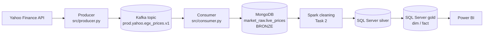

# Kafka Live Ingestion (Task 1)

Brings **live stock prices** from the Yahoo Finance API into **MongoDB (raw / bronze layer)**, using **Apache Kafka** as the transport between the two.

This is part of the graduation project *Automated Financial Market Data Pipeline* (Egyptian stocks and indices, EGX).

## What this task delivers

| Piece | File | Job |
|---|---|---|
| Kafka broker + topic | `docker-compose.yml` | Receives and stores messages, in order, until they are read |
| Producer | `src/producer.py` | Yahoo API -> Kafka (one message per stock per round) |
| Consumer | `src/consumer.py` | Kafka -> MongoDB (`market_raw.live_prices`) |
| Message format | `src/messages.py` | The JSON schema, validation, unique id of a candle |
| Test helpers | `src/send_test_message.py`, `src/check_mongo.py`, `src/check_yahoo.py` | Fake data without the API; inspect MongoDB; check Yahoo candle sizes |
| Data sharing | `src/export_mongo.py`, `src/import_mongo.py` | Move the loaded data to a teammate's MongoDB |
| Unit tests | `tests/test_messages.py` | Tests of the message logic |

## Where it fits in the whole pipeline



**This task covers only the part from the API to MongoDB.** Cleaning (Spark) and loading to SQL Server are Task 2. Historical CSV files do not go through Kafka; they were loaded in bulk earlier.

## Quick start (details in `docs/02_step_by_step_guide.md`)

```powershell
copy .env.example .env
docker compose up -d                      # Kafka + topic
docker compose --profile mongo up -d      # MongoDB (skip if you already run it on port 27017)
python -m venv .venv
.venv\Scripts\Activate.ps1
pip install -r requirements.txt

python src/send_test_message.py --count 5     # fake data, proves Kafka works
python src/consumer.py --max-messages 5       # Kafka -> MongoDB
python src/check_mongo.py                     # see what arrived

python src/producer.py --once --ignore-market-hours   # real data from Yahoo
```

## Documentation

1. [`docs/01_kafka_concepts.md`](docs/01_kafka_concepts.md) – Kafka explained from zero
2. [`docs/02_step_by_step_guide.md`](docs/02_step_by_step_guide.md) – every step to run this, with expected output
3. [`docs/03_design_decisions.md`](docs/03_design_decisions.md) – why it is built this way (topic, key, schema, guarantees)
4. [`docs/04_troubleshooting.md`](docs/04_troubleshooting.md) – common errors and fixes
5. [`docs/05_task1_report.md`](docs/05_task1_report.md) – task report: what was built, findings, test results, hand-over to Task 2 and Airflow
6. [`docs/06_sharing_the_data.md`](docs/06_sharing_the_data.md) – how to share the loaded MongoDB data with teammates

## Work split inside the pair

| Member | Owns | Done when |
|---|---|---|
| Member 1 (Kafka) | `docker-compose.yml`, topic, `producer.py`, `symbols.txt` | `producer.py --once` sends one message per symbol and they are visible in Kafka |
| Member 2 (Mongo) | `consumer.py`, `check_mongo.py`, indexes, dead-letter handling | messages sent by the producer (or `send_test_message.py`) appear in MongoDB without duplicates |

They meet at the topic: Member 1 can test with the console consumer, Member 2 can test with `send_test_message.py`.

## Definition of done

- [ ] `docker compose up -d` starts Kafka and the topic exists (3 partitions)
- [ ] `producer.py --once --ignore-market-hours` delivers one message per symbol
- [ ] `consumer.py` stores them in `market_raw.live_prices`
- [ ] Running the producer twice does not create duplicate documents (same candle = same `_id`)
- [ ] A broken message goes to `live_prices_dead_letter`, the consumer keeps running
- [ ] Stopping MongoDB and starting it again loses no messages
- [ ] `python -m unittest discover -s tests` passes
- [ ] Screenshots / outputs saved in `docs/evidence/` (see step 13 of the guide)

## Status

Unit tests of `messages.py` pass. The Docker, Kafka, MongoDB and Yahoo parts must be run on your own machine; record your results in `docs/evidence/`.
